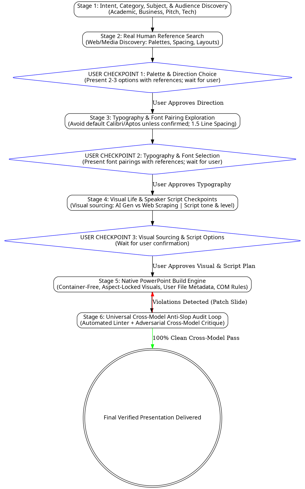

# Human Presentation (Anti-Slop Master Skill)

## The Core Philosophy: Slop vs. Human Craft

Most AI slide makers (Claude, ChatGPT, Gemini, Copilot, Gamma, Canva) suffer from **Distributional Convergence ("Zombie UI")** and the **Render Target Fault Line**. Because models default to the statistical median of web templates (Tailwind/shadcn flexbox boxes), they reflexively generate floating rounded rectangle cards, purple gradients, emojis, unreadable ASCII diagrams, and unchosen default system fonts (Calibri/Aptos). When translated to Microsoft PowerPoint's deterministic coordinate system, layouts clip and fonts break.

**Human Craft Principles:**
1. **Mandatory User Dialogue & Options Exploration (HARD GATE):** The agent must NEVER act autonomously without presenting options, exploring trade-offs, and securing user choices for color palettes, typography, visual sourcing, and narrative structure.
2. **Universal Cross-Model Slop Auditing:** Every agent running this skill—regardless of whether it is Gemini, Claude, ChatGPT, or an open-weights model—MUST audit its output against ALL model-specific slop patterns (Gemini must audit against Claude's and ChatGPT's tells; Claude must audit against Gemini's and ChatGPT's tells). No model is exempt.
3. **Quiet Canvas, Zero Box Cards:** Eliminate all rounded rectangles, floating grey boxes, and card borders. Pure whitespace, subtle 1px dividers, and typography define layout grouping.
4. **Real-World Reference Grounding:** Colors, typography, and layout cadence are never left to AI default reflexes. They must be grounded in real-world human presentation prototypes discovered via web/media research (Google, YouTube, Pinterest, Behance).
5. **Avoid Unchosen Default Fonts:** Do not reflexively default to PowerPoint's built-in font (Calibri / Aptos). Default fonts are acceptable *only* if explicitly approved by the user; otherwise, explore and offer deliberate typography pairings.
6. **Visual Life & Intentional Image Sourcing:** Presentations must not be sterile text skeletons. Ask the user whether to source visuals via **AI Image Generation** (engineered 2D textbook/vector prompts) or **Web/Media Scraping** (authentic photography, real UI screenshots, CC-licensed archives).
7. **Native In-Built Typography:** Enforce a strict 1.5 line spacing on body text, **Bold** category lead-ins, *Italic* parameters/variables, and <u>Underlined</u> final values.
8. **Human File Metadata (Anti-Watermarking):** Presentation document properties (`docProps/core.xml`, `BuiltInDocumentProperties`) must be set to the User's name, institution, and project title—purging all traces of "Claude", "Gemini", "ChatGPT", "Python-PPTX", or "PptxGenJS".
9. **Cognitive Neuro-Design & Attention Architecture:** Ground every slide in perceptual neuroscience (0.25s Recognition → 0.75s Emotion → >1.0s Analysis), Duarte's 3-second Glance Test, Gestalt grouping, Sweller's Cognitive Load Theory (split-attention ban), and an Anchor → Dense → Breathing multi-slide pacing cadence.
10. **165-System Canonical Human Design Library:** Draw visual tokens from 11 domain-specific registries (CORP, FIN, MKT, TECH, ACAD, SCI, EDU, CREA, EDIT, TRAV, ARCH) via deterministic 4-gate selection and session CIELAB $\Delta E \ge 15$ anti-convergence cooldown.
11. **No Filler Structural Bloat:** Standalone roadmap slides are strictly opt-in; closing slides use a clean minimal academic/contact format or a decision CTA—never verbose fluff.
12. **Iterative Self-Critique Audit Loop:** A deck is never finalized on the first pass. It must pass an automated mechanical lint check and an adversarial self-survey against the 66 AI Slop Rules before delivery.

---

## The Non-Negotiable Pre-Flight Gates

Before generating any slide, verify these 12 hard gates:
1. **[HARD GATE — USER OPTIONS]** Have you presented 2–3 curated design directions and color palettes to the user with references and secured their choice?
2. **[HARD GATE — VISUAL SOURCING]** Have you asked the user for their visual preference (**AI Image Generation** vs **Web Search/Scraping** vs **Minimalist**)?
3. **[HARD GATE — DEFAULT FONT]** Did you avoid unchosen default Office fonts (Calibri/Aptos) unless the user explicitly selected it?
4. **[HARD BAN]** Are all floating rectangular box cards and nested card-in-card shapes removed? (Use container-free whitespace).
5. **[HARD BAN]** Is the colored accent bar/line under the slide title deleted? (Separate titles with pure whitespace $\ge 0.35''$).
6. **[HARD BAN]** Are emojis (🚀, 💡, ✨, 📌), WordArt, and glowing drop shadows 100% eliminated?
7. **[HARD BAN]** Are all body paragraphs and multi-quadrant bullet points formatted with **1.5 line spacing**? (Dense calculations use 1.25–1.30).
8. **[REFLEX]** Has the color palette been grounded in human references using the **60–30–10 rule** (Neutral Canvas / Primary / Single Sharp Accent)?
9. **[REFLEX]** Are headings written as **Action Titles / Assertion Headers** rather than passive topic labels?
10. **[REFLEX]** Is an unsolicited Roadmap/Timeline slide avoided unless explicitly requested with real dates and owners?
11. **[HARD BAN]** Is closing fluff (*"Looking forward to your journey"*) banned in favor of a Minimal Academic / Decision closing?
12. **[HARD BAN — METADATA]** Are document properties/metadata configured with the User's name and title, stripping all AI generator tags?

---

## The 6-Stage Human Presentation Lifecycle

---

### Stage 1: Intent, Category, Subject, & Audience Discovery

Before touching colors, fonts, or slides, the agent must extract and lock in four foundational parameters:
1. **Category & Domain Taxonomy (11 Canonical Domains):**
   * Map the topic into 1 of the 11 domain registries in `references/design-systems/`:
     * `CORP`: Corporate Business, Strategy & Management Consulting (McKinsey, BCG, Bain).
     * `FIN`: Finance, Banking, Private Equity, Venture Scale-Up & Investor Pitch.
     * `MKT`: Marketing, Branding, DTC Consumer Goods & Product Launch.
     * `TECH`: Startup, SaaS, Systems Architecture, Hardware & Developer Keynotes.
     * `ACAD`: Academic, Higher Education, Thesis Defense & Peer-Reviewed Monographs.
     * `SCI`: Scientific, Medical, Clinical Trials, Biotechnology & Engineering (Strictly CVD-Safe).
     * `EDU`: Education, K-12, E-Learning, University Courseware & Interactive Training.
     * `CREA`: Creative Portfolios, Avant-Garde Design Studios, Motion VFX & Streetwear.
     * `EDIT`: Aesthetic, Editorial Lookbooks, Luxury Fashion, Fine Jewelry & Haute Horlogerie.
     * `TRAV`: Travel, Hospitality, Culinary Arts, Luxury Resorts & Wine/Bistro Guides.
     * `ARCH`: Architecture, Real Estate Development, Sustainability & Non-Profit ESG.
2. **Subject Precision:**
   * Pinpoint the exact field (e.g., *Electronics & DC/AC Theory*, *Supply Chain & Cold Logistics*, *Cloud Infrastructure*).
3. **Delivery Medium & Optical Ergonomics (Canvas Polarity Physics):**
   * *Piepenbrock Acuity Law:* Positive light polarity (dark text on light ground) delivers superior visual acuity and prevents astigmatism halation. Data-dense consulting, financial, academic, and boardroom presentations must default to light or light-tinted paper grounds (`#FFFFFF`, `#FAF8F5`, `#F8F9FA`, `#F5F0E8`).
   * *Dark Mode Exception:* Dark polarity belongs strictly in dimly lit auditoriums, evening keynotes, luxury gala pitches, and OLED demos. When justified, use tinted charcoal grounds (`#121514`, `#1D1E20`, `#1E1E2E`) and off-white text (`#F4F5F8`, `#F5F5F5`), never pure black/white, or adopt a **Bookend Sandwich Structure** (dark covers/dividers, crisp white analytical interiors).
   * *Recorded Video Assessment:* Requires visible candidate webcam placement space, explicit slide-by-slide pacing, and synchronized verbal cues.
4. **Governing Thought & Thesis Spine (STR-04 Rule):**
   * Draft a single-sentence Governing Thought (the core conclusion the deck proves) supported by 3–5 MECE pillars.
   * *Output of Stage 1:* Feeds category, subject, and venue into Stage 2's design system selector and reference search engine.

---

### Stage 2: Real Human Reference Discovery & Design System Selection

Never hallucinate or accept AI default colors. Combine the 165-system Canonical Human Design Library with live web/media research:

* **Deterministic Design System Selection (`scripts/select_design_system.js`):**
  * Run `node <skill-path>/scripts/select_design_system.js <CATEGORY> [VENUE] [--cvd]`.
  * The selector enforces 4 Priority Gates (Brand Precedence → Domain Routing → Venue Ergonomics → Accessibility/CVD Gate) and an Anti-Convergence Engine enforcing a 10-deck session cooldown and CIELAB $\Delta E \ge 15$ distance from previous decks and banned AI-slop anchors.
* **Targeted Web/Media Search:**
  * Supplement with targeted searches across Google, YouTube presentation breakdowns, Pinterest, Behance, and SlideShare:
    `"[Category] [Subject] presentation slides design" site:pinterest.com OR "pitch deck behance"`
* **Extract Human Design Dimensions:**
  * **Color Palette (60–30–10):** Neutral Canvas (`BG`), Deep Headline (`PRIMARY`), Sharp pop (`ACCENT`), Dark Slate (`TEXT`), Muted (`MUTED`). Tag low-contrast accents (<3.0:1) strictly as `[FILL]`.
  * **Component Placement:** Notice how human designers use asymmetric 50/50 and 65/35 splits, full-width row lists, and white gutters instead of box cards.
  * **Visual Motifs & Transitions:** Identify subtle divider lines, authentic photography, or clean technical drafting.
* **MANDATORY USER CHECKPOINT 1:**
  The agent **MUST NOT** proceed automatically. Present 2–3 curated options (selected from the 165 systems + live references) with rationale and benchmark sources to the user for confirmation. (See [references/human-reference-guide.md](references/human-reference-guide.md) and [references/design-systems/](references/design-systems/)).

---

### Stage 3: Typography Exploration & Windows Font Architecture

* **Audited Windows 11 & Microsoft 365 Cloud Font Architecture:**
  * Consult [references/windows-font-fallback-matrix.json](references/windows-font-fallback-matrix.json) for zero-substitution font pairings.
  * *Windows 11 Native Tier:* Georgia, Cambria, Constantia, Palatino Linotype, Sitka Display, Segoe UI, Franklin Gothic Medium, Candara, Corbel, Trebuchet MS, Consolas, Cascadia Mono.
  * *Microsoft 365 Cloud Tier:* Avenir Next LT Pro, Neue Haas Grotesk Text Pro, Bierstadt, Tenorite, Abadi, Garamond, Bookman Old Style, Bodoni MT, Rockwell, Perpetua, Century Gothic, News Gothic MT, Agency FB.
  * *Critical Typographic Traps:*
    * **Bahnschrift PDF Bug:** Non-Regular weights collapse to Regular upon PowerPoint PDF export. Exclude Bahnschrift from PDF decks; use Franklin Gothic Medium or News Gothic MT.
    * **Baskerville Old Face / Bell MT:** Lack genuine Bold/Bold Italic styles. Reserve strictly for display titles or substitute Bookman Old Style / Georgia.
* **Avoid Default Office Fonts:** Do not automatically select `Calibri` or `Aptos`. Only use default fonts if explicitly confirmed by the user. Otherwise, present deliberate pairings:
  * *Option A (Modern Academic / Technical):* Segoe UI Display Bold (Titles) + Segoe UI Regular (Body).
  * *Option B (Editorial / Gravitas):* Georgia Bold (Titles) + Calibri (Body).
  * *Option C (Classic Scholarly):* Cambria Bold (Titles) + Calibri (Body).
  * *Option D (Clean Executive Sans):* Trebuchet MS Bold (Titles) + Arial (Body).
* **MANDATORY USER CHECKPOINT 2:**
  Present font pairing options to the user with sample hierarchy and wait for user alignment.
* **Line Spacing Mandate:**
  * **1.5 Line Spacing** (`SpaceWithin = 1.45–1.5`) applied to all explanatory paragraphs, bullet blocks, and quadrant descriptions.
  * **1.25–1.30 Line Spacing** strictly for multi-step arithmetic derivations to prevent vertical overflow.
* **In-Built Formatting Roles:**
  * **Bold:** Category prefixes (`• Architecture:`, `• Total Resistance:`).
  * *Italics:* Physical variables, formulas, and phase shifts (*Vin*, *Rin*, *Av*, *180° phase shift*).
  * <u>**Underline**</u>: Final calculated values (`<u>**550 Ω**</u>`) and governing laws.
  * Unicode math: True superscripts/subscripts (`2² = 4`, `2⁸ - 1`, `13₁₀`), proper multiplication (`×`, `·`). Never use `*` as multiplication.

---

### Stage 4: Visual Life & Speaker Script Checkpoints

Presentations must not become sterile text skeletons. Before writing code, execute these mandatory user checkpoints:

1. **Visual Sourcing Checkpoint (AI Generation vs. Web Scraping):**
   * Ask the user how they would like visual assets sourced to bring the deck to life:
     * **Mode A: AI Image Generation (Engineered Prompts):** Crisp 2D textbook vector schematics, architecture stacks, waveform graphs on pure white backgrounds (`#FFFFFF`).
     * **Mode B: Web Search / Media Scraping:** Authentic high-resolution photography, real system UI screenshots, CC-licensed Wikimedia/Unsplash imagery.
     * **Mode C: Minimalist / Pure Typography:** Restrained editorial layout with zero illustrative images.
2. **Speaker Script User Checkpoint:**
   * Ask if a speaker script is needed:
     * If yes (or already requested), prompt for:
       * **Tone:** Academic / Defense, Executive / Boardroom, Conversational / Explanatory, or Pitch.
       * **Spoken English Level:** Plain Conversational English (simple, active sentences, clear phonetics), Formal Academic, or Simplified English.
     * If the user opts out, skip script generation and proceed with slide production.
3. **MANDATORY USER CHECKPOINT 3:**
   Wait for user selection on Visual Sourcing and Speaker Script preferences before proceeding to build.

---

### Stage 5: Native PowerPoint Build Engine & Cognitive Attention Architecture

Build the presentation natively (via PowerShell COM, python-pptx, or OOXML) applying the empirical rules in [references/design-psychology-rules.md](references/design-psychology-rules.md):
* **Cognitive Neuro-Design Pacing & Art Direction Archetypes (Zero-Repetition Mandate):**
  * *Zero-Repetition Mandate:* **Never repeat the identical layout structure across consecutive slides.** Ban the mechanical "split-screen formula" (repeating bullets-left / square-photo-right on multiple slides).
  * *Deploy at least 5 of the 8 Creative Archetypes per 10-slide deck:*
    1. **ARC-01 Full-Bleed Atmospheric Scrim:** 100% canvas photography with 40-60% dark gradient scrim; large cinematic assertion header in quotation marks.
    2. **ARC-02 Horizontal Letterbox Panorama:** Top 60% continuous panoramic landscape/monument strip; bottom 40% generous whitespace with 2-3 editorial takeaway columns.
    3. **ARC-03 Vertical Full-Height Edge Bleed:** Right 45% full-height photo/schematic slice bleeding top-to-bottom; left 55% elevation markers and assertion insights.
    4. **ARC-04 Gaze-Cued Portrait Split:** Subject portrait on left looking across the canvas toward the headline and core takeaway on right.
    5. **ARC-05 Container-Free Step Chain:** Horizontal progression (`01` $\to$ `02` $\to$ `03`) separated by pure column gutters and 0.75pt hairlines; zero card boxes.
    6. **ARC-06 Dual-Image Macro/Micro Contrast:** 1 large establishing environment shot + 1 small macro detail vignette on an asymmetric grid.
    7. **ARC-07 Typographic Monument & Void:** $\ge 65\%$ negative whitespace; massive 72-120pt statistic/metric anchored by a single-sentence punchline.
    8. **ARC-08 Asymmetrical 70/30 Exhibit Split:** 70% width high-density native chart/matrix + 30% strategic executive takeaway sidebar.
  * *Anchor Slides:* High-contrast covers, section dividers, and single-metric heroes (1 big stat + 1 sentence).
  * *Dense Evidence Slides:* Analytical charts, matrices, and tables (capped at two consecutive dense slides; whitespace $\ge 35\%$).
  * *Breathing / Pattern-Interrupt Slides:* Full-bleed scrimmed photography, inverted-polarity pull quotes, or sparse comparisons inserted every 3–4 slides to reset the brain's orienting reflex.
* **5 Spatial Placement Mechanics:**
  1. *Asymmetric Tension & Rule of Thirds:* 2/3 Exhibit + 1/3 Insight or 35/65 editorial splits.
  2. *Deliberate Negative Space Framing:* $\ge 0.5''$ outer margins, breathing room around titles.
  3. *Reflexive Face Attention & Gaze Cueing:* Portraits positioned on the left facing right toward the core takeaway (never looking off-slide).
  4. *Directional Leading Lines & Slicing:* 45° diagonal seams, structural dividers, and vector pointers guiding eye scan paths.
  5. *Z-Axis Depth Layering Without Drop Shadows:* Geometric ground (Layer 1) → Display type (Layer 2) → Background-removed photo cutout overlapping lettering (Layer 3).
* **Theatrical Color Lighting:**
  * 60% quiet canvas ground, 30% structural primary, 10% reserved spotlight accent.
  * Selective desaturation: Mute baseline bars to neutral gray (`#9AA3AF`, `#B5BDC8`) and illuminate only the winning series in accent1.
* **Exact OOXML `theme1.xml` Mapping:**
  * Map selected tokens to standard slots: `dk1` (Body ink / dark canvas), `lt1` (Canvas ground / light ink), `dk2` (Muted ink baseline), `lt2` (Surface tint), `accent1` (30% Primary), `accent2` (10% Spotlight), `accent3–accent6` (CVD-safe data series).
* **Human Document Metadata (Anti-Watermarking):**
  * Populate presentation metadata (`docProps/core.xml` / `BuiltInDocumentProperties`) with the User's credentials:
    * `Author` / `Creator`: User's full name / student name.
    * `LastModifiedBy`: User's name.
    * `Title`: Official presentation title.
    * `Company` / `Manager`: User's university or organization.
  * Strip all generator tool strings ("Claude", "Gemini", "ChatGPT", "Python-PPTX", "PptxGenJS").
* **Container-Free Layouts:** Zero floating box cards. Use whitespace and 1px hairlines (`#CBD5E1`) for separation.
* **Engineered Visuals Integration:**
  * Aspect-ratio lock all visuals directly onto the slide canvas with equal padding and zero enclosing border shapes. (See [references/diagram-engineering-prompts.md](references/diagram-engineering-prompts.md)).
* **COM Mechanical Safeguards:**
  * Assemble multi-line text using single carriage returns (`` `r ``) to eliminate character index drift.
  * Load JSON using explicit UTF-8 encoding.
  * Enforce `<a:noAutofit>` and check `TextFrame2.TextRange.BoundHeight` for overflow. (See [references/native-powerpoint-spec.md](references/native-powerpoint-spec.md)).

---

### Stage 6: Universal Cross-Model Anti-Slop Audit Loop

**DO NOT finalize the presentation immediately upon initial generation.** The agent must run an internal audit loop:

1. **Universal Cross-Model Enforcement Rule:**
   * Regardless of whether the agent generating the slide is Gemini, Claude, or ChatGPT:
     * **Gemini agents MUST check and fix Claude tells** (italic serif title ends, warm cream/terracotta slop, bold-first compulsive counting) AND **ChatGPT tells** (quietly ignoring negative constraints, "In today's world", listicle bloat, yellow image cast).
     * **Claude agents MUST check and fix Gemini tells** (Tailwind/HTML trap, mid-deck dark/light drift, static screenshot charts) AND **ChatGPT tells**.
     * **Every agent must audit against the complete 66-rule registry.**
2. **Automated Mechanical Linting:**
   * Run `node <skill-path>/scripts/lint_slop.js <presentation.json>`.
   * Linter verifies: Banned buzzwords (`delve`, `tapestry`, `supercharge`), literal bullets (`• •`), emojis, em-dash overuse, title underline characters, and unsolicited roadmaps.
3. **Adversarial Self-Critique Survey:**
   * Inspect generated slides or exported PNGs against the **66 AI Slop Rules** in [references/anti-slop-bans.md](references/anti-slop-bans.md).
   * Verify line spacing (1.5x), container-free grouping (no card boxes), action titles, and human metadata.
4. **Patch & Repeat:**
   * Apply targeted fixes to violating slides.
   * Repeat until the presentation receives a **100% Clean Pass** from the linter and self-survey before presenting the final result to the user.

---

## Detailed References & Automation Suite

### Core Empirical References
* [references/anti-slop-bans.md](references/anti-slop-bans.md): Complete 66 AI Slop Master Registry (TYP-01 to VIS-10) with cross-model audit rules.
* [references/design-psychology-rules.md](references/design-psychology-rules.md): Master neuro-design cognitive attention spec, Gestalt grouping, Sweller/Mayer cognitive load, 5 spatial placement tactics, theatrical color lighting, and Anchor-Dense-Breathing multi-slide pacing cadence.
* [references/windows-font-fallback-matrix.json](references/windows-font-fallback-matrix.json): Windows 11 pre-installed & Microsoft 365 Cloud Font tiers, Bahnschrift PDF export bug warning, Baskerville Old Face limits, and OOXML font embedding schema.
* [references/design-systems/](references/design-systems/): 11 sharded JSON libraries containing all 165 canonical Human Design Systems (`01-corp-consulting.json` through `11-architecture-esg.json`) with full 12-key Section 1.3 schema.
* [references/works-cited-310.md](references/works-cited-310.md): Complete 310-entry Works Cited bibliography from pages 94–109 spanning empirical journals, institutional design monographs, brand guidelines, and color repositories.
* [references/human-reference-guide.md](references/human-reference-guide.md): Web/media discovery protocol, image sourcing choices, and user option templates.
* [references/diagram-engineering-prompts.md](references/diagram-engineering-prompts.md): Master prompts for circuit schematics, graphs, digital logic, and architecture stacks.
* [references/native-powerpoint-spec.md](references/native-powerpoint-spec.md): Windows paths, OOXML DrawingML `theme1.xml` template (Page 90), 12-slot `a:clrScheme` mappings, `MsoThemeColorIndex` 13–16 rule, human file metadata script APIs, COM index drift fixes, and empirical WCAG/CIELAB benchmark datasets.

### Automation & Tooling Suite (`scripts/`)
* [scripts/select_design_system.js](scripts/select_design_system.js): Deterministic 4-gate selector (Brand Precedence → Domain Routing → Venue Ergonomics → Accessibility/CVD Gate) with 10-deck cooldown and CIELAB $\Delta E \ge 15$ anti-convergence engine.
* [scripts/compile_theme_xml.js](scripts/compile_theme_xml.js): Generates compliant DrawingML `theme1.xml` mapping system tokens to `dk1`, `lt1`, `dk2`, `lt2`, `accent1`–`accent6`, `hlink`, `folHlink`, and major/minor font schemes.
* [scripts/embed_fonts_ooxml.js](scripts/embed_fonts_ooxml.js): Enforces the 4 OOXML font embedding schema constraints in `ppt/presentation.xml` (child variant order `regular -> bold -> italic -> boldItalic`, parent insertion before `defaultTextStyle`, `pitchFamily="2" charset="0"`, `nameID="1"` verbatim match, and OS/2 `fsType` permission check).
* [scripts/build_native_deck.js](scripts/build_native_deck.js): Template-first PowerPoint builder binding shapes, text, and native charts (`<c:chart>` / `ppChartBarClustered`) strictly to `schemeClr` and `+mj-lt/+mn-lt`, enforcing 1.5 line spacing, container-free layouts, action headers, and human file metadata.
* [scripts/render_qa.js](scripts/render_qa.js): Hardware-accelerated Win32COM Slide.Export to 1920×1080 PNG generator producing structured `qa_manifest.json` for vision model inspection and human QA.
* [scripts/lint_slop.js](scripts/lint_slop.js): Universal mechanical anti-slop linter enforcing all 66 slop rules, mathematical WCAG 2.1 contrast calculation ($C = \frac{\max(L_1, L_2) + 0.05}{\min(L_1, L_2) + 0.05}$), and CIELAB $\Delta E \ge 15$ distance checks against the 12 banned AI-slop color anchors.
* [scripts/ingest_design_systems.js](scripts/ingest_design_systems.js): Section 8.4 deterministic 4-gate ingestion tool for scaling to 50–100+ systems (Zero-Duplicate Hash, WCAG 2.1 Role Tagging, Dual Font Pairing, and 66-Rule Pre-Check).
